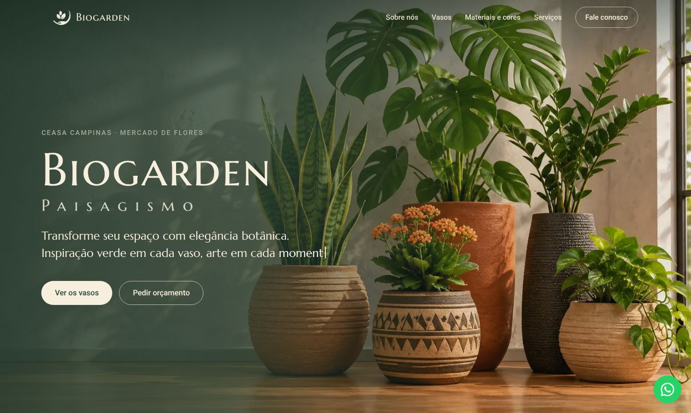
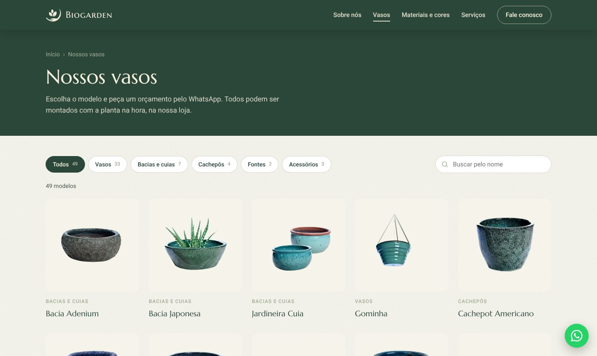
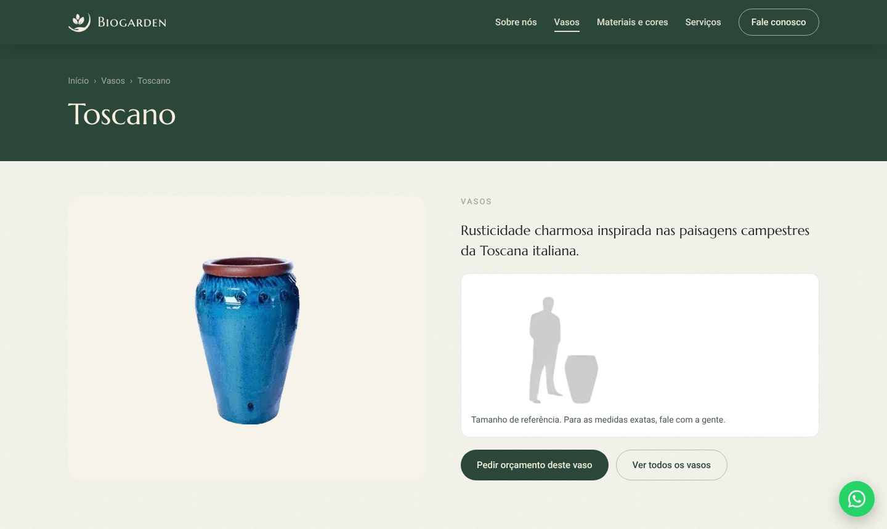

# Biogarden 2.0

New version of the website for **Biogarden Paisagismo**, a real client that sells decorative pots and offers landscaping services at Ceasa Campinas (Mercado de Flores), Brazil.

**Live:** https://biogarden-2.vercel.app



## About the project

The first version of this site was built with plain HTML, CSS and JavaScript ([old site](https://feernandoignacio.github.io/Biogarden-Paisagismo/)). Version 2.0 rebuilds it from scratch with Next.js and TypeScript, keeping the brand identity (green, cream and the Marcellus font) while improving structure, performance and how the business is found and shared online.

## Features

- **Vase catalog** with 49 models, filters by type and accent-insensitive search
- **A page for each vase** (`/vasos/[slug]`), statically generated, with a size reference and a "request a quote" button that opens WhatsApp with the vase name already filled in
- **Glazes and materials** shown in tabs, with photos of each finish
- **Services and location** sections, with an embedded map and a "get directions" link
- **Share previews**: a custom image for the site and one for each vase, so links sent on WhatsApp show the product photo
- **SEO**: sitemap, robots.txt, canonical URLs and LocalBusiness structured data (address, opening hours, phone)
- **Custom 404 page** in the brand style
- **Responsive layout** that scales from phones to large monitors, with an accessible mobile menu
- **Reduced motion support** for the typing animation and hover effects

| Catalog | Vase page | Mobile |
| --- | --- | --- |
|  |  |  |

## Tech

- [Next.js](https://nextjs.org) (App Router, static generation)
- React and TypeScript
- CSS Modules
- `next/image` for optimized images and `next/font` with self-hosted fonts
- Deployed on Vercel

## Project structure

```
src/
  app/              Routes: home, /vasos, /vasos/[slug], sitemap, robots, 404
  components/       Header, Hero, About, Catalog, ProductCard, Finishes, Services...
  data/             Site info, vase catalog, glazes and materials
  fonts/            Self-hosted Marcellus and Roboto
public/
  images/           Optimized photos (WebP)
  og/               Share preview images for each vase
```

## Running locally

```bash
npm install
npm run dev
```

Open http://localhost:3000.

## Next steps

- Admin panel with login and a database, so the client can add and edit vases on his own
- Custom domain

## Author

Developed by Lucas Fernando. [LinkedIn](https://www.linkedin.com/in/dev-lucas-fernando/)
