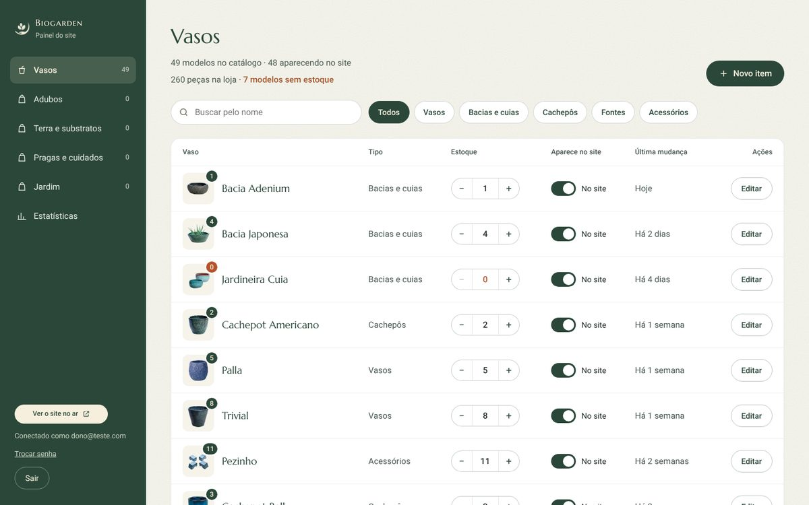
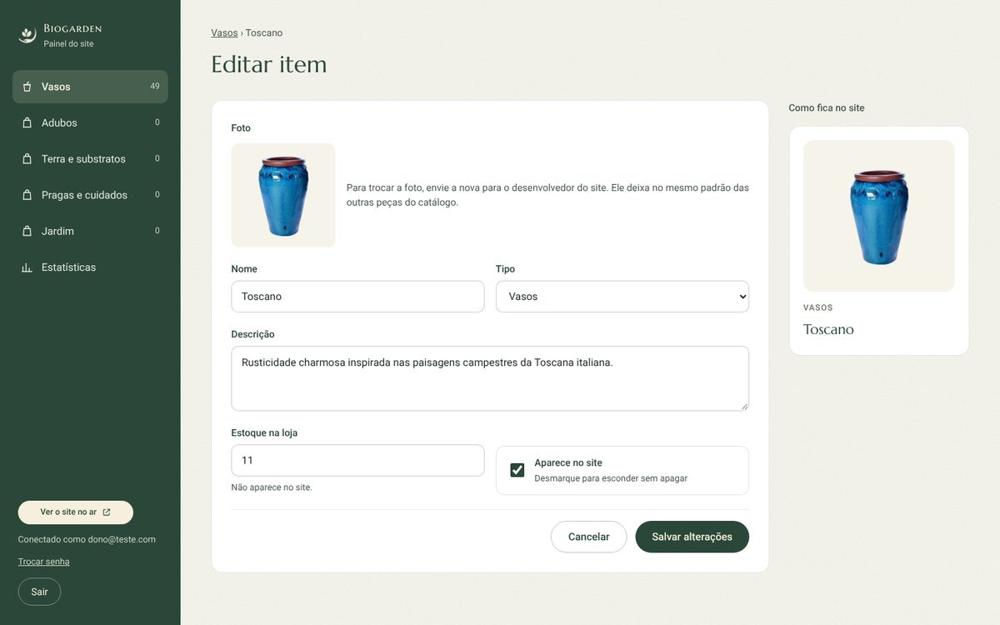
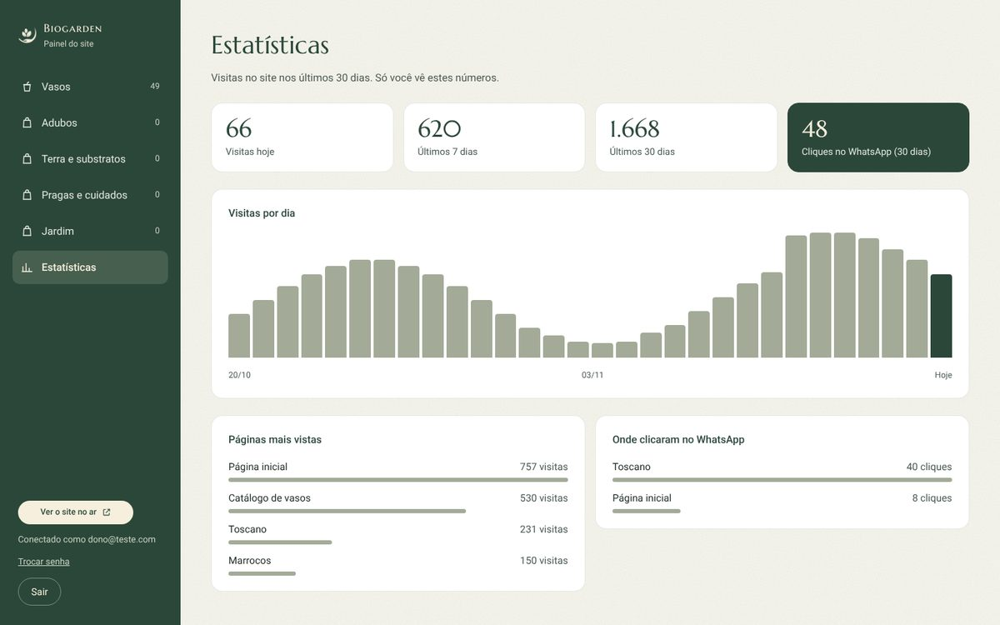
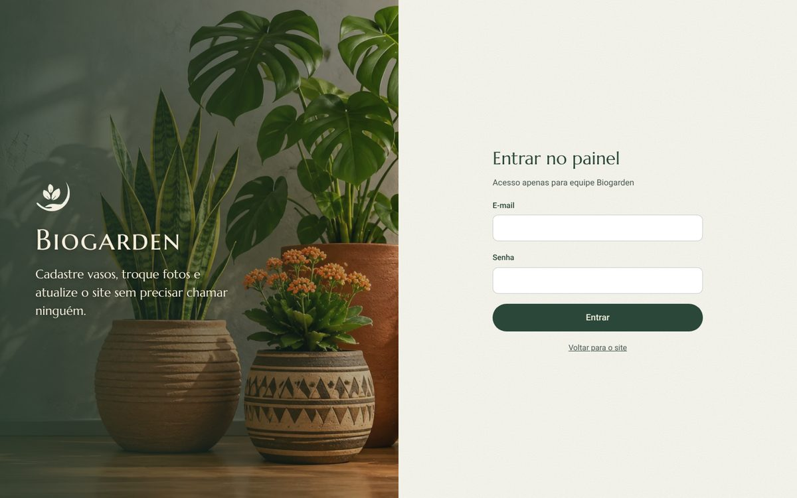
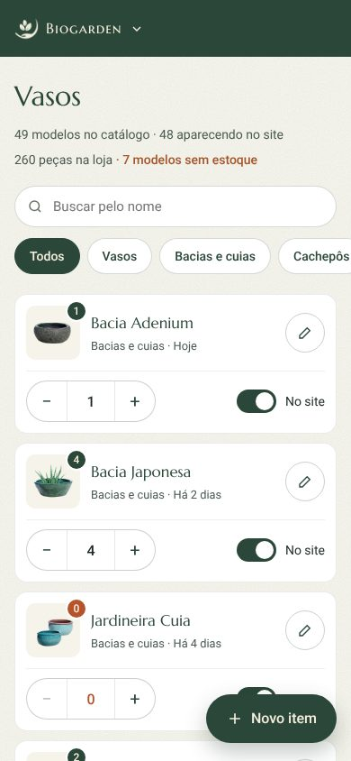

# Biogarden 2.0

Website and admin panel for **Biogarden Paisagismo**, a real client that sells decorative pots and offers landscaping services at Ceasa Campinas (Mercado de Flores), Brazil.

**Live:** https://biogarden-2.vercel.app


## About the project

The first version of this site was built with plain HTML, CSS and JavaScript ([old site](https://feernandoignacio.github.io/Biogarden-Paisagismo/)). Version 2.0 rebuilds it from scratch with Next.js and TypeScript, keeping the brand identity (green, cream and the Marcellus font) while improving structure, performance and how the business is found and shared online.

On top of the public site, it now has an **admin panel** where the owner manages the catalog and the physical store's stock on his own, from the computer or the phone, without touching code.

## Public site

- **Vase catalog** with filters by type and accent-insensitive search, loaded from the database
- **A page for each vase** (`/vasos/[slug]`), statically generated, with a size reference and a "request a quote" button that opens WhatsApp with the vase name already filled in
- **Glazes and materials** shown in tabs, with photos of each finish
- **Services and location** sections, with an embedded map and a "get directions" link
- **Share previews**: a custom image for the site and one for each vase, so links sent on WhatsApp show the product photo
- **SEO**: sitemap, robots.txt, canonical URLs and LocalBusiness structured data (address, opening hours, phone)
- **Subtle page transitions** and sections that fade in on scroll, respecting reduced motion settings
- **Custom 404 page** in the brand style
- **Responsive layout** that scales from phones to large monitors

| Catalog | Vase page | Mobile |
| --- | --- | --- |
|  |  |  |

## Admin panel (`/painel`)

- **Login** with email and password (sign-ups are disabled; only the owner's account exists) and a screen to change the password
- **Catalog management**: edit name, type and description, and show or hide each vase on the site without deleting it. Changes reach the site instantly
- **Store stock control**: quantity per item with quick +/- buttons. Stock is never sent to the public site
- **Store categories** (fertilizers, soil and substrates, pest care, garden) for products that are only tracked in the store, not shown on the site
- **Draft items**: the owner can register new items, but they stay off the site until the developer adds a photo in the catalog's standard. Only drafts can be deleted
- **Statistics**: visits per day, most viewed pages and WhatsApp clicks, counted without cookies or personal data
- **Mobile layout** with cards, large touch targets and a menu that opens from the logo
- **Branded loading screen** while data is being fetched

| Item list | Edit item |
| --- | --- |
|  |  |

| Statistics | Login | Mobile |
| --- | --- | --- |
|  |  |  |

## How the data is protected

All rules live in the database (Supabase Row Level Security), not only in the interface:

- Visitors can only read visible vases, and only the columns the site needs. Stock and statistics are unreadable without login
- An item without a photo, or outside the Vases category, can never be shown on the site
- Only draft items (without a photo) can be deleted; published vases can only be hidden
- Visits are recorded through a database function that can only add 1 to a page; it cannot read or delete anything

## Tech

- [Next.js](https://nextjs.org) 16 (App Router, Cache Components, Server Actions, `proxy.ts`)
- React 19 and TypeScript
- [Supabase](https://supabase.com): Postgres, Auth and Row Level Security
- Cached catalog with `use cache` and cache tags, refreshed on every save in the panel
- CSS Modules
- `next/image` for optimized images and `next/font` with self-hosted fonts
- Deployed on Vercel (São Paulo region)

## Project structure

```
src/
  app/
    (site pages)    Home, /vasos, /vasos/[slug], sitemap, robots, 404
    painel/         Admin panel: login, item lists, edit, statistics, password
  components/       Header, Hero, Catalog, ProductCard, Finishes, VisitTracker...
  data/             Site info, catalog queries, glazes and materials
  lib/supabase/     Supabase clients (public and with the owner's session)
  proxy.ts          Protects the admin panel and refreshes the session
supabase/
  migrations/       Database tables, access rules and seed data
public/
  images/           Optimized photos (WebP)
  og/               Share preview images for each vase
```

## Running locally

Create a `.env.local` file (see `.env.example`):

```
NEXT_PUBLIC_SUPABASE_URL=...
NEXT_PUBLIC_SUPABASE_PUBLISHABLE_KEY=...
```

Then:

```bash
npm install
npm run dev
```

Open http://localhost:3000 (site) or http://localhost:3000/painel (admin panel).

## Next steps

- Custom domain
- Password reset by email (needs a custom SMTP provider, planned together with the domain)

## Author

Developed by Lucas Fernando. [LinkedIn](https://www.linkedin.com/in/dev-lucas-fernando/)
